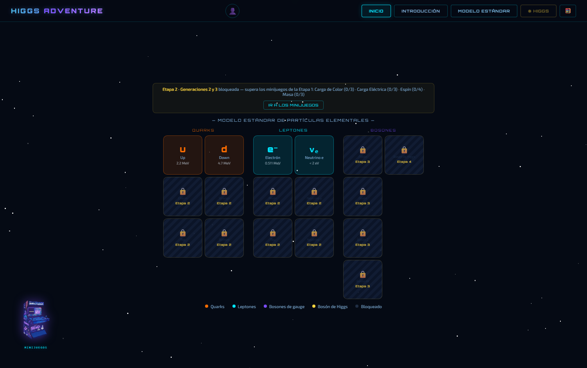
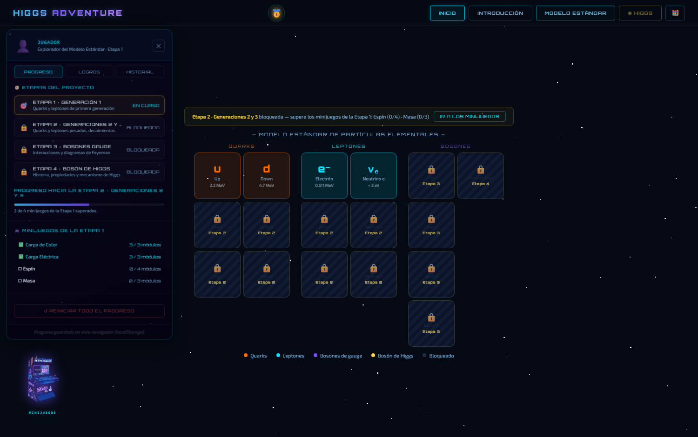
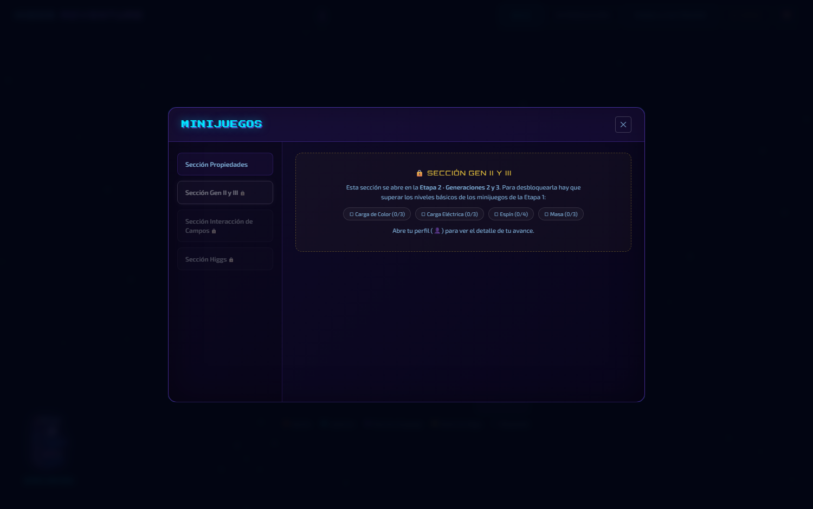
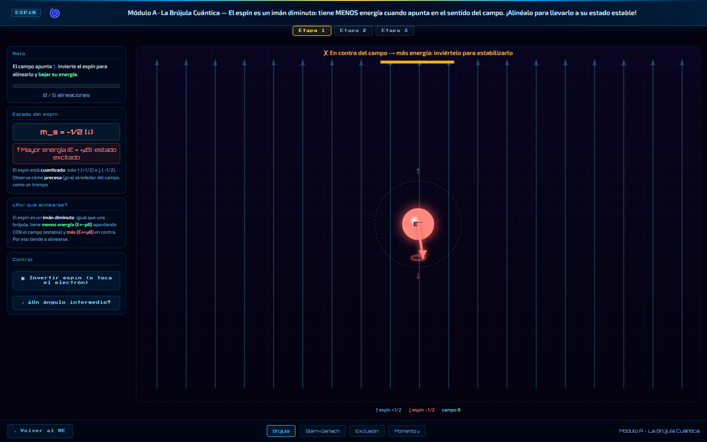
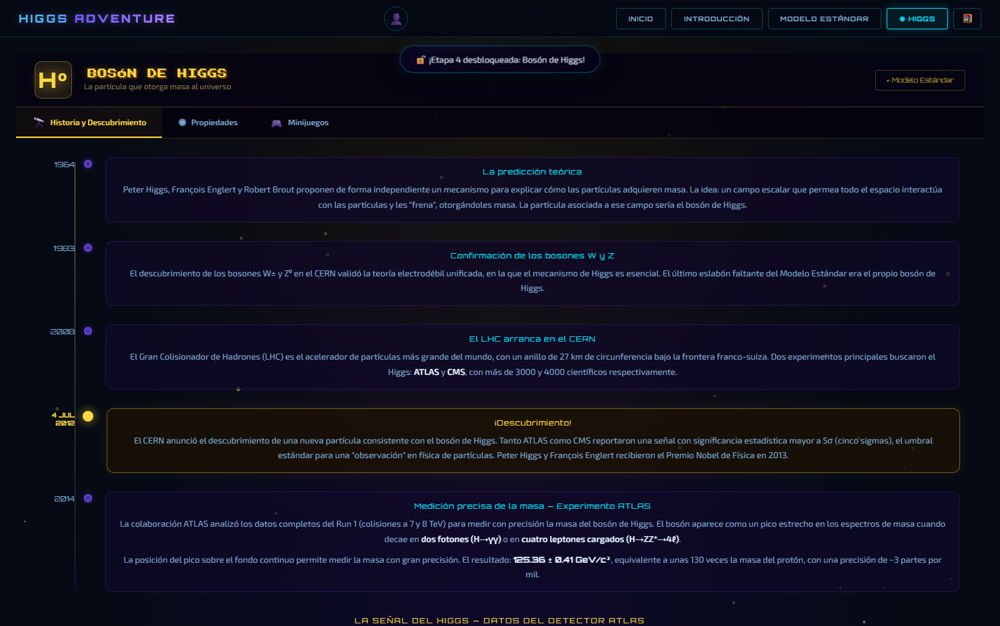
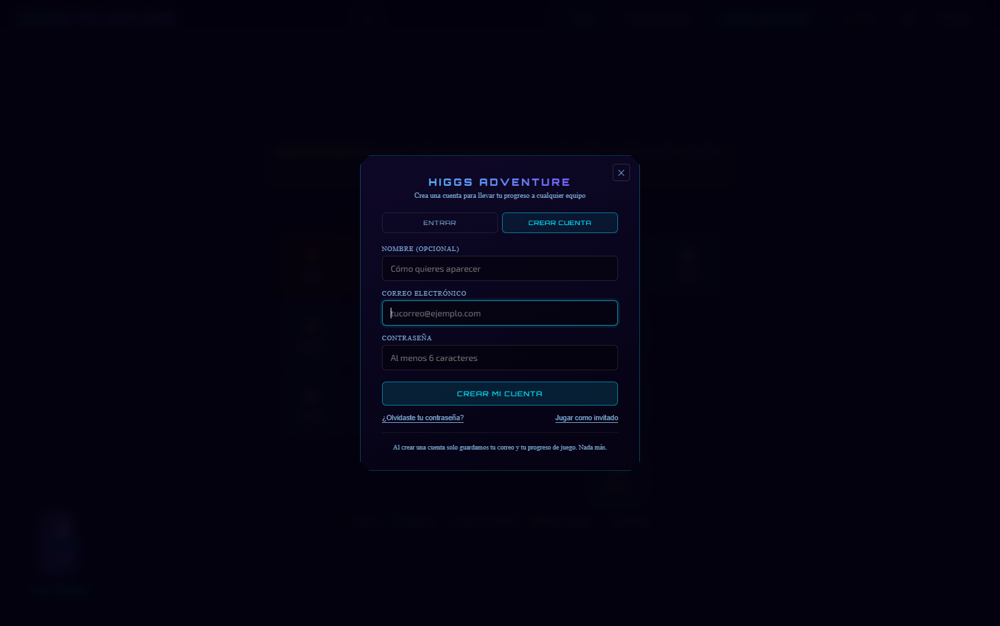
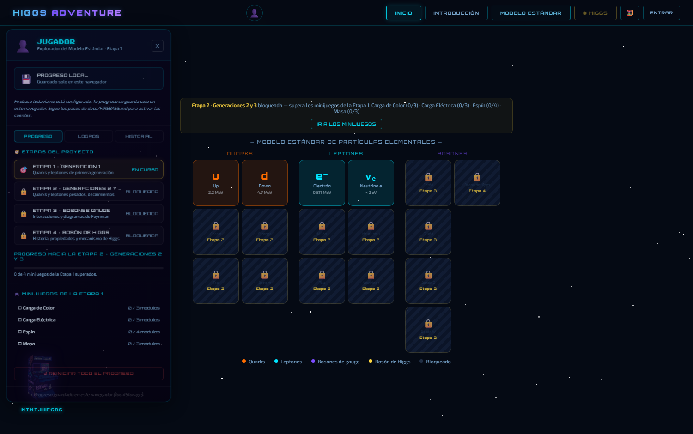

# Higgs Adventure: plataforma web interactiva para el aprendizaje gamificado del Modelo Estándar de Partículas

## Resumen

El proyecto **Higgs Adventure** consiste en el desarrollo de una plataforma web interactiva y gamificada en español para facilitar la comprensión del Modelo Estándar de física de partículas y el mecanismo de Higgs, dirigida a estudiantes de nivel medio superior y superior, así como al público general.

La plataforma organiza el contenido en niveles progresivos que abarcan desde la historia del átomo y la mecánica cuántica hasta el estudio detallado del bosón de Higgs, incluyendo todas las partículas elementales con sus propiedades fundamentales (carga eléctrica, carga de color, espín y masa).

El aprendizaje se refuerza mediante minijuegos diseñados para que, al completar diferentes niveles, el usuario adquiera conocimiento de manera interactiva sobre dichas propiedades y sobre los bosones gauge a través de diagramas de Feynman, culminando en un módulo del bosón de Higgs con secciones histórica, experimental e interactiva.

Además, se contempla la implementación de un sistema de logros que recompense al usuario por sus conocimientos alcanzados. Se prevé publicar la página en un sitio gratuito y distribuirla inicialmente en aulas de educación media superior en México para impactar positivamente la enseñanza de la física moderna.

---

## Gamificación

La gamificación es una herramienta pedagógica la cual consiste en la aplicación de elementos y técnicas propias de los juegos (como puntos, niveles, desafíos, etc.) en contextos que no son lúdicos, con el objetivo de motivar, comprometer y facilitar el aprendizaje o la realización de tareas.

En lugar de limitarse a presentar información de forma estática, la gamificación transforma el proceso de aprendizaje en una experiencia activa, entretenida y gratificante, lo que aumenta la retención del conocimiento y la participación del usuario.

### Relación con el proyecto Higgs Adventure

#### Estructura por niveles de desbloqueo progresivo
Al igual que en un videojuego, el usuario no accede a todo el contenido del modelo estándar de una sola vez, sino que debe avanzar paso a paso. Esto evita la sobrecarga cognitiva y genera una sensación de logro gradual.

#### Minijuegos interactivos para reforzar propiedades e interacciones
En lugar de memorizar tablas de partículas, el usuario aprende conceptos como carga eléctrica, carga de color, espín y masa mediante minijuegos. Por ejemplo, tiene que "agrupar" correctamente quarks y sus cargas de color. Esto convierte el aprendizaje abstracto en una actividad práctica y lúdica.

#### Sistema de logros y recompensas
Se implementa un sistema que otorga trofeos al completar ciertos desafíos dentro de los minijuegos. Estas recompensas refuerzan positivamente el esfuerzo del usuario, incentivándolo a seguir explorando contenidos más avanzados.

#### Adquisición de conocimiento mediante la acción
La gamificación asegura que el usuario no sea un mero espectador, sino que "aprenda haciendo". Cada nivel completado y cada minijuego superado representa un avance tangible en su comprensión del Modelo Estándar.

---

## Estructura por etapas del proyecto

### Etapa 0 – Introducción interactiva
El usuario comienza en un apartado de introducción interactiva, donde adquiere los conceptos físicos fundamentales y los acontecimientos históricos necesarios para comprender el desarrollo del Modelo Estándar. Esta etapa sienta las bases conceptuales previas al estudio de las partículas elementales.

### Etapa 1 – Modelo Estándar interactivo (Generación 1)
Una vez completada la introducción, el usuario accede al apartado del Modelo Estándar interactivo. Inicialmente, únicamente se encuentran desbloqueadas las partículas de la primera generación de quarks y leptones.

A través de minijuegos diseñados para reforzar las propiedades de carga de color, carga eléctrica y espín, el usuario aprende de manera lúdica dichas características. Al superar los niveles básicos requeridos de estos minijuegos, se desbloquea el acceso a la siguiente etapa.

### Etapa 2 – Generaciones 2 y 3 de quarks y leptones
El usuario desbloquea la segunda y tercera generaciones de quarks y leptones. Como consecuencia, se activan nuevos minijuegos asociados a fenómenos propios de estas generaciones, tales como decaimiento de partículas, radiación y desintegración.

Una vez completados los niveles básicos de estos minijuegos, el usuario avanza a la etapa subsecuente.

### Etapa 3 – Bosones gauge y diagramas de Feynman
El usuario desbloquea a los bosones gauge. Mediante minijuegos que simulan diagramas de Feynman, el usuario adquiere conocimientos sobre las interacciones mediadas por estos bosones. Al completar los niveles básicos correspondientes, se habilita el acceso a la etapa final.

### Etapa 4 – Bosón de Higgs
El usuario desbloquea el bosón de Higgs, accediendo a un nuevo apartado donde se aborda la historia de su formulación teórica y su descubrimiento experimental, además de conocer sus propiedades. Se desbloquean también nuevos minijuegos orientados a comprender el mecanismo de Higgs.

### Retroalimentación entre etapas
Todas las etapas están concebidas con un carácter retroalimentativo. Esto implica que, a medida que el usuario desbloquea nuevo contenido (generaciones superiores de partículas, bosones gauge y el bosón de Higgs), los minijuegos ya existentes —de ser posible— se actualizan incorporando nuevos niveles basados en dichas partículas recién desbloqueadas, permitiendo así un aprendizaje cíclico, acumulativo y cada vez más profundo.

---

## Estado del desarrollo

### Estructura de archivos

```
index.html                  punto de entrada (carga todo en orden)
js/progreso.js              progreso, desbloqueos y logros  ← fuente única de verdad
js/data.js                  partículas, propiedades y pasos de introducción
js/navigation.js            cambio de pantallas y control de desbloqueos
js/modelo-estandar.js       grid del ME (con celdas bloqueadas por etapa)
js/detail.js                panel de detalle de una partícula
js/higgs-screen.js          módulo del bosón de Higgs
js/intro.js                 introducción interactiva
js/perfil.js                panel de perfil (progreso · logros · historial)
js/calculadora.js           calculadora científica flotante
js/home-sphere.js           canvas de la esfera energética
js/home-geo.js              canvas de geometría del inicio
minijuegos/js/data-minijuegos.js   registro de secciones y minijuegos
minijuegos/js/minijuegos.js        hub de minijuegos
minijuegos/js/minijuego-*.js       un archivo por minijuego
tools/verificar.js          comprobaciones automáticas del proyecto
```

### Minijuegos implementados

| Minijuego | Etapa | Estado |
|---|---|---|
| Carga de Color | 1 | jugable |
| Carga Eléctrica | 1 | jugable |
| Espín | 1 | jugable |
| Masa | 1 | jugable |
| Decaimiento | 2 | jugable |
| Rayos Cósmicos | 2 | jugable |
| Fotón (Feynman) | 3 | jugable |
| Gluón, Bosón Z, Bosones W± | 3 | pendientes |
| Campo de Higgs, Diagramas de Higgs | 4 | pendientes |

### Capturas

Grid del Modelo Estándar: solo la primera generación está accesible y el resto
muestra la etapa en la que se desbloquea.



Panel de perfil con el avance por etapas, los minijuegos superados y el progreso
hacia la siguiente etapa.



Una sección de minijuegos todavía bloqueada explica qué falta para abrirla.



Minijuego de Espín (Etapa 1), sobre el fondo cuadriculado común.



Módulo del bosón de Higgs, que se abre en la Etapa 4.



### Sistema de progreso y desbloqueo

El desbloqueo progresivo es el eje pedagógico del proyecto y está implementado en
`js/progreso.js`. Es la **fuente única de verdad** para el avance, los logros y el
historial; se guarda en `localStorage` bajo la clave `higgs_progreso`.

Regla: **para abrir la etapa N hay que superar los niveles básicos de todos los
minijuegos de la etapa N−1.**

| Etapa | Contenido que desbloquea | Minijuegos que hay que superar |
|---|---|---|
| 1 | Quarks y leptones de gen. 1 | *(abierta desde el inicio)* |
| 2 | Quarks y leptones de gen. 2 y 3 | Carga de Color, Carga Eléctrica, Espín, Masa |
| 3 | Bosones gauge | Decaimiento, Rayos Cósmicos |
| 4 | Bosón de Higgs | Fotón |

La exigencia de cada minijuego se mide en **módulos superados**. El número necesario
está en `MODULOS_REQUERIDOS` (dentro de `js/progreso.js`) y se puede ajustar en un
solo sitio.

Los minijuegos informan de su avance con dos llamadas:

```js
Progreso.moduloCompletado('spin', 'brujula');            // un módulo superado
Progreso.registrarPartida('foton', { puntaje: 620 });    // una ronda puntuada
```

Las claves de módulo se guardan en un conjunto, así que repetir la misma clave
nunca infla el progreso.

### Cómo verificar el proyecto

```bash
node tools/verificar.js
```

Comprueba que todos los CSS/JS enlazados y los assets de los minijuegos existen,
que no hay archivos huérfanos, que cada minijuego marcado como disponible tiene su
función `iniciar_<id>()`, que la lógica de desbloqueo por etapas funciona
(progresión, persistencia y migración de historiales antiguos) y que la capa de
autenticación está bien formada (configuración, reglas de Firestore y fusión de
progreso entre el equipo y la nube).

### Cuentas de usuario (Firebase)

El sitio puede funcionar con cuentas para que el progreso de cada alumno lo siga
entre computadoras. **Es opcional y está desactivado por defecto**: mientras no se
configure, todo funciona como siempre con el progreso guardado en el navegador.

Los pasos están en **[docs/FIREBASE.md](docs/FIREBASE.md)**. En resumen: crear un
proyecto en Firebase, pegar su configuración en `js/firebase-config.js`, activar
los proveedores «Correo electrónico/contraseña» y «Anónimo», y pegar las reglas de
[`firestore.rules`](firestore.rules) en la consola.



El diseño del acceso es **invitado primero**: el alumno empieza a jugar sin
registrarse (por dentro se le crea una cuenta anónima y su progreso ya se guarda
en la nube) y, cuando quiera, crea una cuenta con su correo. En ese momento el
progreso **se conserva**, porque la cuenta anónima se vincula al correo en lugar
de reemplazarse.



Archivos que intervienen:

| Archivo | Papel |
|---|---|
| `js/firebase-config.js` | Configuración y comportamiento (invitado sí/no, etc.) |
| `js/auth.js` | Módulo con el SDK: registro, acceso, invitado, vinculación y pantalla |
| `js/progreso.js` | Guarda localmente y sincroniza con Firestore, fusionando ambos |
| `js/perfil.js` | Sección de cuenta dentro del panel |
| `css/auth.css` | Estilos de la pantalla de acceso |
| `firestore.rules` | Reglas de seguridad (cada usuario solo ve lo suyo) |

Nota importante: con cuentas activadas hay que abrir el sitio desde un servidor
local (`http://`), no con doble clic (`file://`). Si se abre con `file://`, el
perfil lo explica en lugar de fallar en silencio.

---

## Conclusiones

El proyecto **Higgs Adventure** representa una propuesta innovadora y necesaria para la enseñanza de la física de partículas en español, al combinar una secuencia didáctica con estrategias de gamificación que transforman conceptos abstractos y complejos en experiencias interactivas accesibles y motivantes.

Su estructura por etapas progresivas y retroalimentativas, que abarca desde los fundamentos históricos hasta el bosón de Higgs, permite que el usuario construya conocimiento de manera gradual y significativa, mientras que los minijuegos y el sistema de logros refuerzan el aprendizaje activo y recompensan el dominio alcanzado.

Al estar dirigido a estudiantes de nivel medio superior y superior, así como al público general, y al contemplar su publicación gratuita y distribución inicial en aulas mexicanas, el proyecto tiene el potencial de impactar positivamente la enseñanza de la física moderna en el sistema educativo nacional, mitigando la escasez de recursos digitales interactivos en español sobre estas temáticas.

---

##  Repositorio

Este repositorio contiene el código fuente y los recursos del proyecto Higgs Adventure.

Para ejecutar el proyecto se inicia index.html
